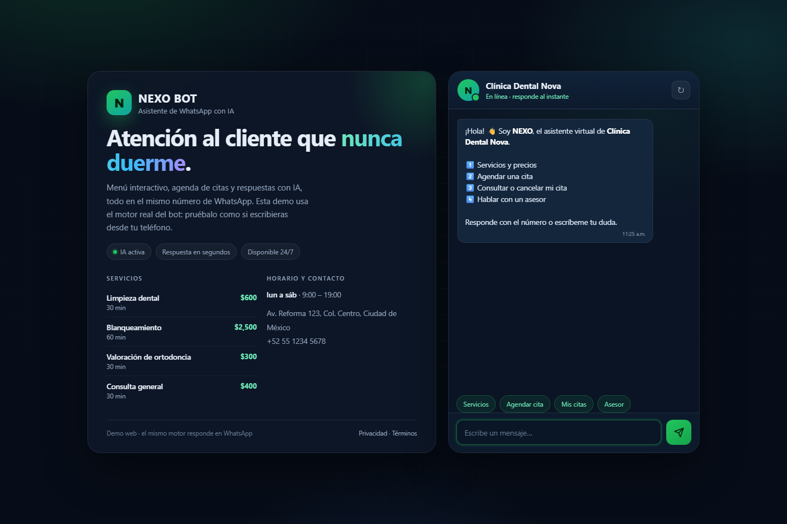

# NEXO BOT

Asistente de WhatsApp con IA para negocios: menú interactivo, preguntas frecuentes y agenda de
citas, con el mismo motor en WhatsApp, web y consola.

[](https://nodejs.org)
[](https://ai.google.dev)
[](https://developers.facebook.com/docs/whatsapp/cloud-api)
[](https://cloud.google.com/run)
[](https://cloud.google.com/firestore)
[](LICENSE)



**Demo en vivo:** https://nexo-bot-7jjwi3rg7q-uc.a.run.app/demo

> La demo pública usa un negocio ficticio y está limitada por IP para no gastar la cuota gratuita
> de Gemini. No agendes citas reales.

---

## Qué hace

- **Menú interactivo** con opciones numeradas: servicios, agendar, consultar/cancelar cita y asesor.
- **Agenda citas reales**: interpreta «mañana», «el viernes» o «30/10», muestra horarios libres,
  valida la zona horaria del negocio y evita dobles reservas.
- **Responde preguntas con Gemini** usando el contexto del negocio, sin inventar precios ni horarios.
- **Respaldo sin IA**: si no hay clave, se agota la cuota o Gemini falla, contesta con preguntas
  frecuentes locales. El menú y las citas nunca dependen del modelo.
- **Avisa al dueño** por WhatsApp cuando entra una cita o alguien pide un asesor.
- **Mismo motor en tres canales**: webhook de WhatsApp, demo web y consola.

## Por qué esta arquitectura

| Decisión | Motivo |
|---|---|
| **WhatsApp Cloud API** (oficial) en vez de Baileys | Sin riesgo de bloqueo del número, sin QR que caduque y con webhooks firmados. Es lo que piden las empresas. |
| **Gemini + Cloud Run + Firestore** en vez de Dialogflow | Todo entra en la capa gratuita. Dialogflow CX cobra por sesión después del periodo de prueba. |
| **Menú determinista + IA** | La IA conversa; el flujo crítico (citas) es código comprobable. Menos alucinaciones y menos latencia. |
| **Adaptador de almacenamiento** | Firestore en producción, memoria en local y pruebas. Cambiar a Postgres es implementar una interfaz. |
| **Fechas como texto local** (`YYYY-MM-DD` / `HH:mm`) | El servidor corre en UTC; el negocio no. Se evitan bugs de zona horaria y de horario de verano. |

## Stack

| Capa | Tecnología |
|---|---|
| Servidor | Node.js 22, Express 5 (ESM) |
| IA | Google Gemini (`@google/generative-ai`) con cadena de modelos y timeout |
| WhatsApp | WhatsApp Cloud API (Meta Graph API) |
| Persistencia | Firestore (producción) y memoria (desarrollo) |
| Despliegue | Docker, Cloud Build, Cloud Run |
| Pruebas | `node:test` |

## Cómo funciona

```
WhatsApp ──webhook firmado──┐
Demo web ──/api/demo────────┼──► motor de conversación ──► menú
Consola  ──CLI──────────────┘            │                  ├── agenda / cancela citas
                                         │                  └── FAQ
                                         ├──► Gemini (con respaldo local)
                                         └──► Firestore / memoria
```

1. Meta envía el mensaje al webhook y NEXO BOT valida la firma HMAC-SHA256.
2. El motor busca la conversación por número y decide: menú, cita o texto libre.
3. Si es texto libre, Gemini responde con el contexto del negocio; si falla, entra el buscador de FAQ.
4. Las citas se guardan en Firestore y el dueño recibe un aviso por WhatsApp.

## Estructura

```
src/
  server.js                 Express: webhook, demo, salud y páginas legales
  cli/                      Chat de terminal
  config/
    env.js                  Carga del .env desde cualquier directorio
    negocio.js              Datos del negocio (servicios, horarios, FAQ)
  services/
    conversacion.js         Motor: estados, intenciones y flujo de citas
    mensajes.js             Textos que ve el cliente
    fechas.js               Fechas en lenguaje natural, zonas horarias y slots
    almacen.js              Firestore / memoria detrás de una interfaz
    ia.js                   Gemini con timeout, reintentos y fallback
    respuestas.js           Buscador de preguntas frecuentes
    whatsapp.js             Firma, envío, deduplicación y parseo del webhook
public/                     Demo web, privacidad y términos
scripts/desplegar.js        Despliegue idempotente en Cloud Run
test/bot.test.js            11 pruebas del motor
docs/
  WHATSAPP-META.md          Guía para conectar un número real
  CV.md                     Texto listo para el currículum
```

## Empezar en local

Requisitos: Node.js 20+ y una clave gratuita de [Google AI Studio](https://aistudio.google.com/app/apikey).

```bash
npm install
copy .env.example .env      # Windows
# cp .env.example .env       # macOS / Linux
npm run dev
```

Abre http://localhost:8080/demo. Sin clave de Gemini la demo sigue funcionando con el respaldo de
preguntas frecuentes.

Otros comandos:

```bash
npm run chat       # conversación en la terminal
npm test           # 11 pruebas automatizadas
npm run deploy     # despliegue en Cloud Run
```

En Windows también puedes usar `Iniciar-Local.bat`, `Probar-Consola.bat` y
`Desplegar-CloudRun.bat` con doble clic.

## Variables de entorno

| Variable | Obligatoria | Para qué |
|---|---|---|
| `GEMINI_API_KEY` | No | Activa las respuestas con IA |
| `GEMINI_MODEL` | No | Fuerza un modelo concreto |
| `GEMINI_TIMEOUT_MS` | No | Tiempo máximo por intento de IA (8000) |
| `BUSINESS_*` | No | Nombre, dirección, teléfono, horario y zona horaria |
| `ALMACEN` | No | `memoria` o `firestore` (en Cloud Run se activa solo) |
| `WHATSAPP_PHONE_NUMBER_ID` | No | Número de WhatsApp Cloud API |
| `WHATSAPP_TOKEN` | No | Token de Meta |
| `META_APP_SECRET` | No | Valida la firma del webhook |
| `META_VERIFY_TOKEN` | No | Reto de verificación del webhook |
| `OWNER_PHONE` | No | Recibe avisos de citas y asesores |
| `DEMO_MAX_MENSAJES` | No | Límite de mensajes por IP en la demo (40) |

La guía completa para conectar WhatsApp está en **[docs/WHATSAPP-META.md](docs/WHATSAPP-META.md)**.

## Despliegue

```bash
npm run deploy
```

El script:

1. Comprueba la sesión de `gcloud` y el proyecto.
2. Activa Run, Cloud Build, Artifact Registry y Firestore.
3. Crea el repositorio de imágenes y la base de datos si no existen.
4. Da permiso `datastore.user` a la cuenta de servicio de Cloud Run.
5. Construye la imagen con Cloud Build.
6. Publica con `--allow-unauthenticated`, 512 MiB y máximo 1 instancia.
7. Imprime la URL de la demo y del webhook.

El archivo de variables se genera en un temporal y se borra al terminar. Para producción seria,
mueve `GEMINI_API_KEY` y `WHATSAPP_TOKEN` a **Secret Manager** y usa `--set-secrets`.

> El webhook solo acepta eventos cuando `WHATSAPP_TOKEN` y `META_APP_SECRET` están configurados
> (en producción). Sin ellos responde `503`, para que nadie pueda simular mensajes y consumir la
> cuota de Gemini.

## Endpoints

| Método | Ruta | Qué hace |
|---|---|---|
| `GET` | `/` y `/demo` | Demo web |
| `POST` | `/api/demo` | Procesa un mensaje `{ sesion, mensaje }` |
| `POST` | `/api/demo/reiniciar` | Reinicia la conversación de la demo |
| `GET` | `/api/negocio` | Datos públicos del negocio |
| `GET` | `/webhook` | Verificación de Meta (`hub.challenge`) |
| `POST` | `/webhook` | Recepción de mensajes de WhatsApp |
| `GET` | `/health` | Estado de IA, WhatsApp y almacenamiento |
| `GET` | `/privacidad`, `/terminos` | Páginas exigidas por Meta |

## Pruebas

```bash
npm test
```

Cubren:

- Fechas en lenguaje natural («mañana», «el lunes», «30/11», «24 de diciembre»).
- Horas como las escribe la gente («4», «4pm», «a las 11», «4 de la tarde»).
- Horarios ocupados que no se ofrecen.
- Bloqueo transaccional para que un horario no se reserve dos veces.
- Flujo completo: menú → servicio → fecha → hora → nombre → confirmación.
- Cancelación con código, aunque el cliente envíe solo el código.
- Reinicio con «menú».
- Respaldo de preguntas frecuentes sin IA.
- Aislamiento entre la demo y WhatsApp.

## Detalles de ingeniería

- **Webhook seguro:** firma HMAC-SHA256 sobre el cuerpo crudo, comparación en tiempo constante y
  deduplicación por `message.id` porque Meta reintenta los eventos.
- **Sin doble reserva:** además de revalidar antes de confirmar, cada bloque `fecha + hora` se
  reserva en una transacción de Firestore. Dos confirmaciones simultáneas no pueden crear la misma cita.
- **Zona horaria:** `Intl.DateTimeFormat` y cadenas locales; no se usan `Date` con offsets manuales.
- **Resiliencia de IA:** timeout de 8 s, reintento ante 429/503, cadena de modelos y fallback FAQ.
- **Rate limiting** por IP en la demo pública para proteger la cuota gratuita.
- **Costo cero:** Cloud Run escala a cero, Firestore tiene 1 GiB gratis y Gemini tiene cuota gratuita.

## Limitaciones y siguientes pasos

- La demo pública no está conectada a un número real: para eso hay que crear la app de Meta
  (20 minutos, ver la guía).
- No incluye panel de administración; las citas se consultan por WhatsApp o en Firestore.
- Los recordatorios proactivos requieren plantillas aprobadas por Meta (fuera de la ventana de 24 h).
- Próximos pasos: panel de conversaciones, recordatorios, sincronización con Google Calendar,
  multi-negocio y métricas de conversión.

## Costes

| Servicio | Capa gratuita | Coste esperado |
|---|---|---|
| WhatsApp Cloud API | Conversaciones de servicio gratuitas | 0 (las plantillas proactivas se cobran) |
| Cloud Run | 2 M peticiones/mes | 0 |
| Firestore | 1 GiB y 50k lecturas/día | 0 |
| Gemini | Cuota gratuita de AI Studio | 0 |
| Cloud Build | 120 min/día | 0 |

## Para el CV

En **[docs/CV.md](docs/CV.md)** hay viñetas en español e inglés, palabras clave para ATS,
preguntas de entrevista y un guion de 30 segundos para presentar el proyecto.

---

## English summary

NEXO BOT is an AI-powered WhatsApp assistant for small businesses. It combines a deterministic
menu with Gemini for open questions, books and cancels appointments with timezone-safe
availability checks, and stores conversations in Firestore. The same engine powers the WhatsApp
webhook, a web demo and a CLI. It runs on Google Cloud Run at zero cost within free tiers.

```bash
npm install && npm run dev     # http://localhost:8080/demo
npm test                        # 11 tests
npm run deploy                  # Cloud Run
```

## Licencia

MIT. Consulta [LICENSE](LICENSE).
